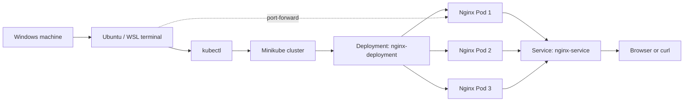

# Kubernetes Hands-on Lab: Nginx Deployment and Pod Self-Healing

A practical beginner-level Kubernetes lab using **Ubuntu on WSL, Minikube, Docker, `kubectl`, and Nginx**. The goal of this project is to understand how Kubernetes runs a containerized application, exposes it for testing, and maintains the desired number of Pods when a Pod is deleted.

This repository captures the hands-on work, the commands used to validate it, common issues encountered during setup, and the fixes applied.

> **Project scope:** This is a local learning project running with Minikube. It is not a production or cloud-hosted deployment. The repository contains reusable manifests prepared from the lab exercises; test them in your own cluster before use.

## Project overview


In this lab, I set up a local Kubernetes cluster, deployed Nginx, tested the web server using `curl`, and used a Deployment to observe how Kubernetes replaces a deleted Pod. I also practised labels, Services, port forwarding, resource inspection, and basic troubleshooting.

### What this project demonstrates

- Setting up and checking a local Kubernetes cluster with Minikube.
- Using `kubectl` to create, inspect, and troubleshoot Kubernetes resources.
- Deploying Nginx as a standalone Pod and as a Deployment.
- Applying YAML manifests instead of relying only on imperative commands.
- Using labels and Service selectors to connect resources.
- Accessing Nginx using `kubectl port-forward` and a NodePort Service.
- Observing Pod lifecycle states and Deployment self-healing.
- Troubleshooting command errors, Service creation, and connectivity issues.

## Architecture

The following diagram describes the main Deployment exercise. Minikube runs locally through Docker; the Deployment manages three Nginx replicas; a Service selects Pods labelled `app: nginx`; and local testing can be done through port forwarding or Minikube's Service URL.



### Request path used for local testing

For the port-forward exercise, the request path is:

```text
Browser / curl
    |
    | http://localhost:8080
    v
kubectl port-forward
    |
    | forwards local port 8080 to Pod port 80
    v
Nginx container
    |
    v
Nginx welcome-page HTML
```

A Pod IP such as `10.244.x.x` is normally an internal cluster address. It may not be directly reachable from the WSL host. `localhost` also means the machine or network namespace where the command is executed, so `localhost:8080` on the WSL host is different from `localhost:8080` inside `minikube ssh`.

## Tools and technologies

| Tool | How it is used |
|---|---|
| Ubuntu / WSL | Linux command-line environment on the Windows machine |
| Kubernetes | Orchestrates Pods and maintains the declared desired state |
| `kubectl` | Creates, inspects, and troubleshoots Kubernetes resources |
| Minikube | Runs a local Kubernetes cluster for practice |
| Docker | Container runtime/driver used by the local Minikube setup |
| Nginx | Sample web server deployed into Kubernetes |
| YAML | Defines Kubernetes Pod, Deployment, and Service resources |
| Git and GitHub | Version control and project portfolio publishing |

## Repository structure

```text
kubernetes-nginx-minikube-lab/
├── README.md
├── manifests/
│   ├── standalone-pod.yaml
│   ├── deployment.yaml
│   └── service.yaml
└── docs/
    ├── images/
    │   └── kubernetes-nginx-project-overview.png
    └── screenshots/
        ├── nginx-curl-success.png
        ├── pod-lifecycle-watch.png
        └── pod-replacement-watch.png
```

Screenshot files may vary depending on which terminal evidence is included in the downloaded copy. Add your own screenshots to `docs/screenshots/` as you complete the exercises.

## Prerequisites

- Windows with Ubuntu on WSL, or another Linux environment.
- Docker installed and running, with Minikube able to use the Docker driver.
- Minikube installed.
- `kubectl` installed and available in `PATH`.
- Internet access for the first download of Kubernetes and Nginx images.

Verify the command-line tools:

```bash
kubectl version --client
minikube version
docker --version
docker ps
```

If `docker ps` cannot connect to the Docker daemon, resolve Docker/WSL integration before starting Minikube.

## Implementation walkthrough

### 1. Start Minikube and verify the cluster

Start the cluster using Docker as the driver:

```bash
minikube start --driver=docker
```

Check its status and node:

```bash
minikube status
kubectl cluster-info
kubectl get nodes
```

The node should eventually report `Ready`. The first start may take several minutes because Minikube needs to download images.

### 2. Deploy a standalone Nginx Pod

The initial exercise used a standalone Pod. Apply the included manifest:

```bash
kubectl apply -f manifests/standalone-pod.yaml
```

Inspect the Pod and its IP:

```bash
kubectl get pods -o wide
kubectl describe pod nginx
kubectl get pod nginx --show-labels
```

Check Nginx's configuration:

```bash
kubectl exec nginx -- nginx -t
```

Expected output includes messages indicating that the Nginx configuration syntax is OK and the test is successful.


### 3. Add a label and expose the standalone Pod

During the original exercise, `kubectl expose pod nginx` failed because the Pod had no labels. A label was added before creating the Service:

```bash
kubectl label pod nginx app=nginx
kubectl get pod nginx --show-labels
```

Create a NodePort Service:

```bash
kubectl expose pod nginx \
  --type=NodePort \
  --port=80 \
  --target-port=80
```

Inspect the Service and its endpoints:

```bash
kubectl get services
kubectl get endpoints nginx
```

If `minikube service nginx --url` reports that the Service does not exist, confirm that the `kubectl expose` command completed successfully. If the Service has no endpoints, check that its selector matches the Pod's labels.

> `10.96.0.1` is commonly the ClusterIP of the built-in `kubernetes` API Service in this cluster. It is not the Nginx Service address and should not be used to test the Nginx web page on port 80.


### 4. Access Nginx using port forwarding

Start port forwarding in one terminal and keep it running:

```bash
kubectl port-forward pod/nginx 8080:80
```

In a second terminal, run:

```bash
curl http://localhost:8080
```

Expected result: HTML containing `Welcome to nginx!`. You can also open `http://localhost:8080` in a browser while port forwarding is active.

Press `Ctrl+C` in the first terminal to stop port forwarding when you are finished. This does not delete the Pod.


### 5. Create a Deployment with three replicas

The Deployment manifest declares three Nginx replicas and labels each Pod with `app: nginx`. Apply the Deployment and Service manifests:

```bash
kubectl apply -f manifests/deployment.yaml
kubectl apply -f manifests/service.yaml
```

Wait for the rollout:

```bash
kubectl rollout status deployment/nginx-deployment
```

Inspect the Deployment, ReplicaSet, Pods, and Service:

```bash
kubectl get deployments
kubectl get replicasets
kubectl get pods -o wide
kubectl get services
```


When all replicas are ready, three Deployment-managed Pods should be visible. Kubernetes may use generated Pod names such as `nginx-deployment-<replicaset-hash>-<suffix>`.

### 6. Access the Deployment

Option A — port-forward to the Deployment:

```bash
kubectl port-forward deployment/nginx-deployment 8080:80
```

In another terminal:

```bash
curl http://localhost:8080
```

Option B — use the Service URL:

```bash
minikube service nginx-service --url
```

Use the exact URL returned by Minikube. NodePort values and returned URLs can differ between environments. If a command remains running while forwarding a port, leave that terminal open until testing is complete.

### 7. Observe Pod self-healing

A Deployment maintains the desired replica count. Deleting one of its Pods does not delete the Deployment; Kubernetes creates a replacement Pod to bring the replica count back to the declared value.

In Terminal 1, watch the Deployment's Pods:

```bash
kubectl get pods -l app=nginx -w
```

In Terminal 2, list the current Pod names:

```bash
kubectl get pods -l app=nginx
```

Delete one current Pod, using its actual name:

```bash
kubectl delete pod <current-pod-name>
```

Replace `<current-pod-name>` with a name shown by the previous command. In the watch terminal, observe the old Pod terminating and a replacement moving through states such as `Pending`, `ContainerCreating`, and `Running`. Intermediate states may appear only briefly.


Useful commands for inspecting the controller and events:

```bash
kubectl get deployment nginx-deployment -w
kubectl describe deployment nginx-deployment
kubectl get events --sort-by=.metadata.creationTimestamp
kubectl get replicasets
```

The exact event sequence and timing depend on the cluster. The important validation is that the Deployment returns to its desired number of ready replicas.

### 8. Scale the Deployment

To change the desired number of replicas:

```bash
kubectl scale deployment nginx-deployment --replicas=2
kubectl get pods -l app=nginx
```

Scale it back to three:

```bash
kubectl scale deployment nginx-deployment --replicas=3
kubectl rollout status deployment/nginx-deployment
```

To stop the Deployment from running Pods without deleting the Deployment object:

```bash
kubectl scale deployment nginx-deployment --replicas=0
```

Restore one replica when ready:

```bash
kubectl scale deployment nginx-deployment --replicas=1
```

### 9. Clean up

Delete the resources created by the manifests:

```bash
kubectl delete -f manifests/service.yaml --ignore-not-found
kubectl delete -f manifests/deployment.yaml --ignore-not-found
kubectl delete -f manifests/standalone-pod.yaml --ignore-not-found
```

If you separately created a Service named `nginx` for the standalone Pod, remove it if it still exists:

```bash
kubectl delete service nginx --ignore-not-found
```

Stop Minikube:

```bash
minikube stop
```

To remove the Minikube cluster entirely, use the following only when you no longer need the local cluster:

```bash
minikube delete
```

## Troubleshooting notes

| Issue | Cause | Fix / check |
|---|---|---|
| `kubectl: command not found` | The binary is not installed in a directory on `PATH` | Install the executable to `/usr/local/bin` and run `kubectl version --client` |
| `kubectl version` attempts to connect to localhost | A command is trying to contact a cluster without a usable context/API server | Use `kubectl version --client` for a client-only check; then check `minikube status` and `kubectl config current-context` |
| `kubectl expose` says the Pod has no labels | The Pod has no labels for a Service selector to use | Add a label with `kubectl label pod nginx app=nginx` and retry |
| `minikube service` reports Service not found | Service creation failed or the name is different | Run `kubectl get services` and use the exact Service name |
| `curl` to a Pod IP fails from WSL | Pod IPs are internal cluster addresses and may not be host-routable | Use `kubectl port-forward` and test `localhost:8080` |
| `localhost:8080` fails inside `minikube ssh` | `localhost` refers to the Minikube node in that shell | Run the host-side curl from another Ubuntu/WSL terminal where port forwarding is active |
| A deleted Pod reappears with a different name | The Pod is managed by a Deployment/ReplicaSet | This is expected self-healing; inspect the Deployment and ReplicaSet |
| `curl` is missing inside a container | The image may not include the `curl` utility | Use host-side port forwarding or a suitable diagnostic container; do not assume Nginx is broken |

## Evidence and screenshots

The screenshots in `docs/screenshots/` are intended to show the actual lab results, including the Nginx HTTP response and the Pod replacement watch. For a stronger portfolio, keep screenshots focused and readable, and avoid including tokens, private keys, account details, or other sensitive information.

## Key learnings

- `kubectl` is a client; installing it does not create a Kubernetes cluster by itself.
- Minikube provides a local cluster for learning Kubernetes concepts.
- A standalone Pod and a Deployment-managed Pod behave differently when deleted.
- Labels and selectors allow Services to find the correct Pods.
- A Pod being `Running` does not automatically mean it is accessible from the host.
- `kubectl port-forward` is a useful local testing method.
- Deployments maintain the desired replica count by replacing deleted Pods.
- `kubectl get`, `describe`, `logs`, and `get events` help investigate resource state and errors.

## Future improvements

These are possible next steps and are not claimed as completed in this lab:

- Customize the Nginx welcome page using a ConfigMap.
- Add resource requests and limits.
- Add readiness and liveness probes and document their behavior.
- Demonstrate a rolling update and rollback.
- Add Ingress and DNS-based access.
- Add a GitHub Actions workflow to validate YAML manifests.
- Deploy the same workload to a managed cloud Kubernetes service after learning the cost and security implications.

## References

- [Kubernetes documentation](https://kubernetes.io/docs/)
- [Minikube documentation](https://minikube.sigs.k8s.io/docs/)
- [kubectl command reference](https://kubernetes.io/docs/reference/kubectl/)
- [Kubernetes Deployments](https://kubernetes.io/docs/concepts/workloads/controllers/deployment/)
- [Kubernetes Services](https://kubernetes.io/docs/concepts/services-networking/service/)
- [Nginx official image](https://hub.docker.com/_/nginx)

---

**Author's note:** This repository documents my hands-on learning with Kubernetes, Minikube, and Nginx. I built the lab incrementally, verified the Nginx response locally, and used Pod deletion to understand how a Deployment restores its desired state.
